# API Daftar Produk (ExpressJS + Prisma)

REST API produk dengan ExpressJS. Data disimpan di database PostgreSQL (Neon) lewat Prisma 7.

## Struktur Proyek

```
├── app.js                      # entry point, setup Express
├── prisma.config.ts            # konfigurasi Prisma (schema, migrasi, seed, DATABASE_URL)
├── prisma/
│   ├── schema.prisma           # model Product
│   ├── migrations/             # riwayat migrasi database
│   └── seed.js                 # data awal (Buku, Pulpen)
├── lib/prisma.js               # instance Prisma Client + adapter PostgreSQL
├── routes/productRoutes.js     # definisi URL + method
├── controllers/productController.js
├── testing.http                # request pengujian (REST Client VS Code)
└── .env.example                # contoh isi .env
```

## Cara Menjalankan

Prasyarat: Node.js 20.19+ dan database PostgreSQL (misalnya Neon).

```bash
npm install
cp .env.example .env          # lalu isi DATABASE_URL
npx prisma migrate deploy     # membuat tabel products
npx prisma generate           # membuat Prisma Client di folder generated/
npm run prisma:seed           # (opsional) isi data awal
npm start
```

Server berjalan di `http://localhost:3000`.

## Daftar Endpoint

| Method | Endpoint        | Deskripsi                                  | Sukses | Gagal    |
| ------ | --------------- | ------------------------------------------ | ------ | -------- |
| GET    | `/products`     | Tampilkan seluruh data                     | 200    | -        |
| GET    | `/products/:id` | Tampilkan satu produk                      | 200    | 404      |
| POST   | `/products`     | Buat data baru                             | 201    | 400      |
| PUT    | `/products`     | Update data (body seperti POST + `id`)     | 200    | 400, 404 |
| DELETE | `/products/:id` | Hapus data berdasarkan id                  | 200    | 404      |

Validasi body POST dan PUT: `name` string tidak kosong, `price` bilangan bulat >= 0, dan khusus PUT `id` bilangan bulat.

### Contoh

**POST /products** -> 201

```json
{ "name": "Penggaris", "price": 7000 }
```

**PUT /products** -> 200

```json
{ "id": 1, "name": "Buku Tulis", "price": 12000 }
```

**DELETE /products/2** -> 200

```json
{ "message": "Produk berhasil dihapus", "data": { "id": 2, "name": "Pulpen", "price": 5000 } }
```

Respons gagal selalu berbentuk `{ "message": "..." }`.

## Cara Menguji

Jalankan server, buka `testing.http` di VS Code (ekstensi REST Client), lalu klik **Send Request** pada tiap skenario (sukses, validasi gagal, id tidak ditemukan). Perubahan data bisa dicek lewat `npx prisma studio` atau dashboard Neon.

## Bukti Pengujian

Pengujian memakai `testing.http` (REST Client) dan database dicek lewat Prisma Studio. Data awal hasil seed: Buku (id 1) dan Pulpen (id 2).

### Skenario Request

| No | Request | Status | Bukti |
| -- | ------- | ------ | ----- |
| 1 | `GET /products` | 200, seluruh produk | 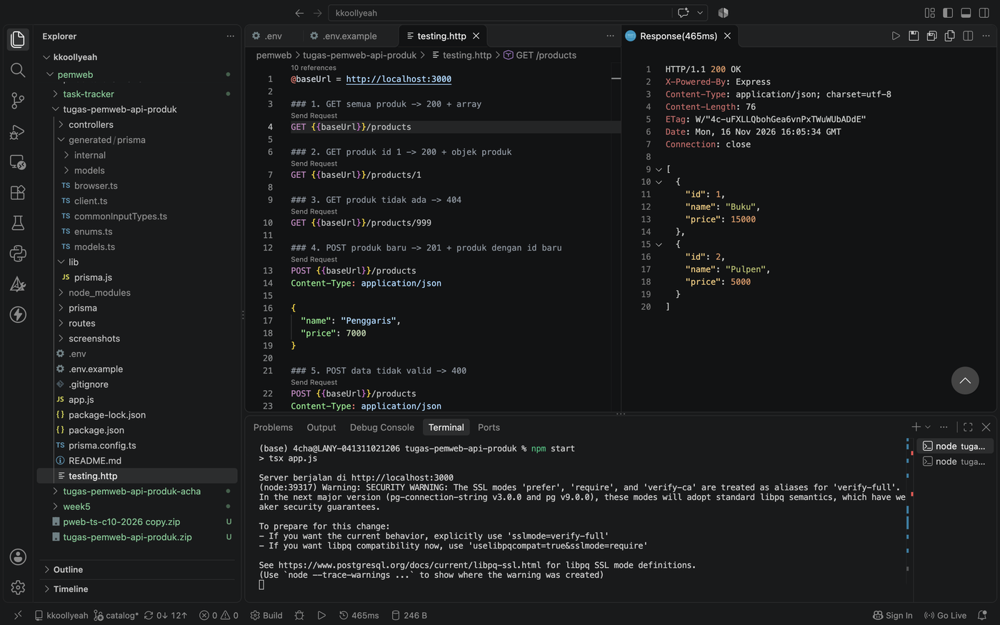 |
| 2 | `GET /products/1` | 200, produk Buku | 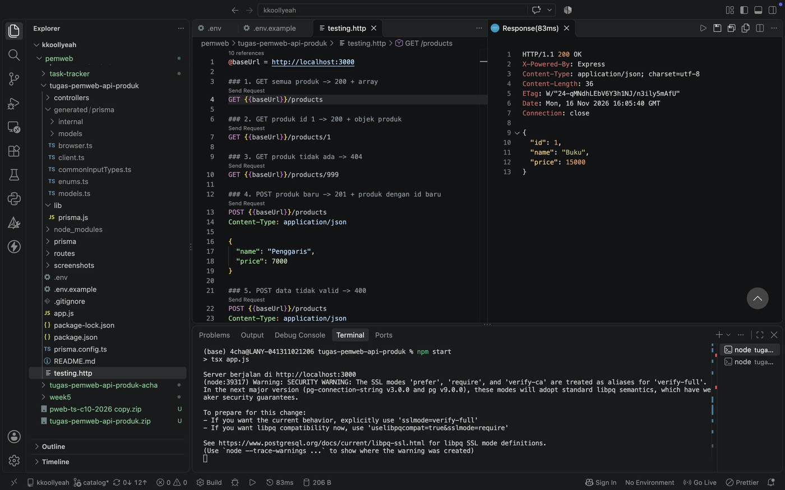 |
| 3 | `GET /products/999` | 404, produk tidak ditemukan |  |
| 4 | `POST /products` (Penggaris, 7000) | 201, produk baru id 3 | 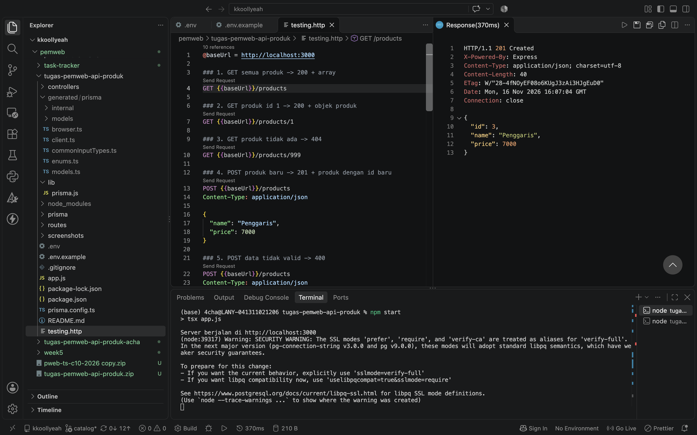 |
| 5 | `POST /products` (name kosong, price "abc") | 400, validasi gagal |  |
| 6 | `PUT /products` (id 1, Buku Tulis, 12000) | 200, data terbaru | 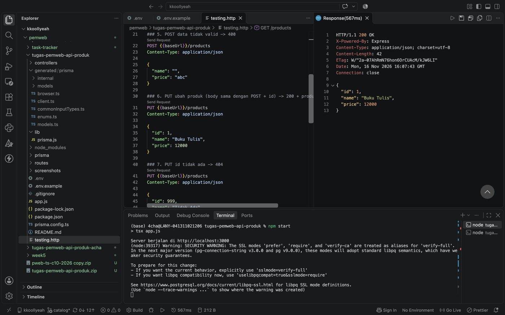 |
| 7 | `PUT /products` (id 999) | 404, produk tidak ditemukan |  |
| 8 | `PUT /products` (tanpa id) | 400, validasi gagal | 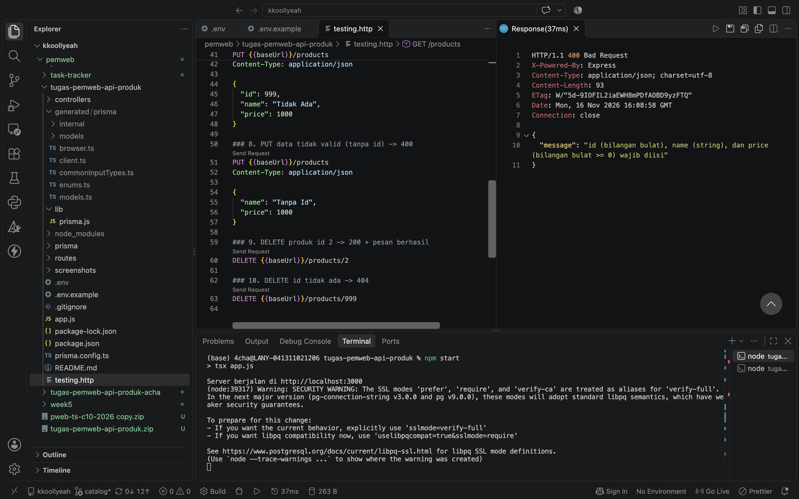 |
| 9 | `DELETE /products/2` | 200, produk Pulpen dihapus | 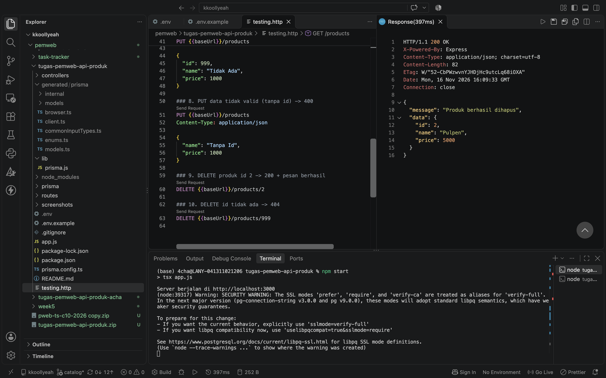 |
| 10 | `DELETE /products/999` | 404, produk tidak ditemukan | 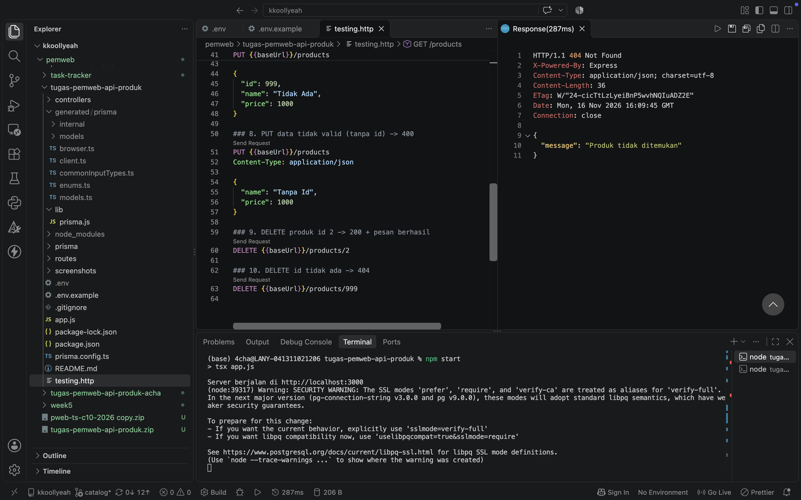 |

### Perubahan pada Database (Before - After)

**Kondisi awal (setelah seed):** Buku dan Pulpen.

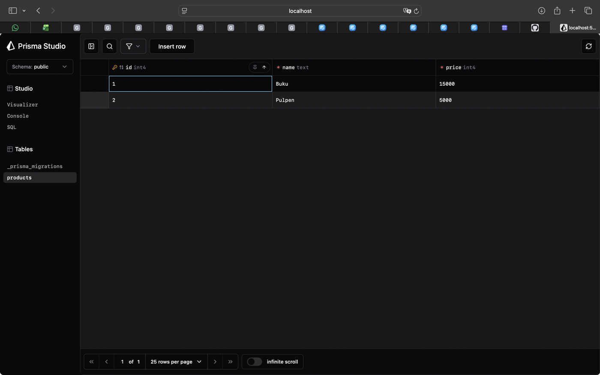

**POST** menambah baris baru (id 3, Penggaris).

| Before | After |
| ------ | ----- |
|  | 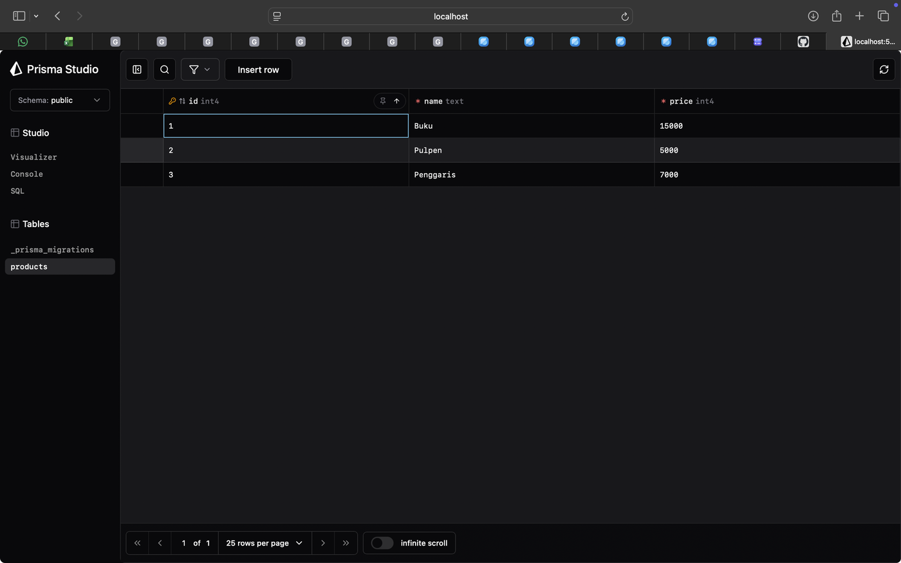 |

**PUT** mengubah id 1 dari Buku (15000) menjadi Buku Tulis (12000).

| Before | After |
| ------ | ----- |
|  | 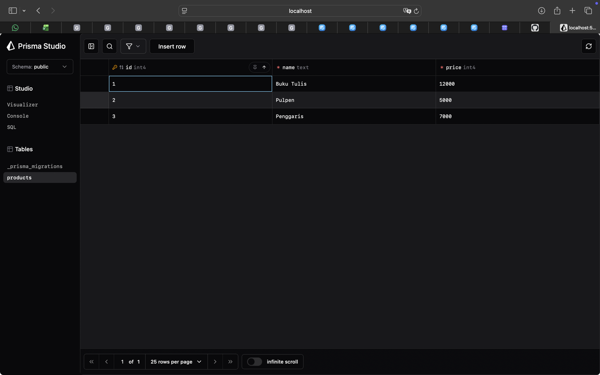 |

**DELETE** menghapus baris id 2 (Pulpen).

| Before | After |
| ------ | ----- |
|  | 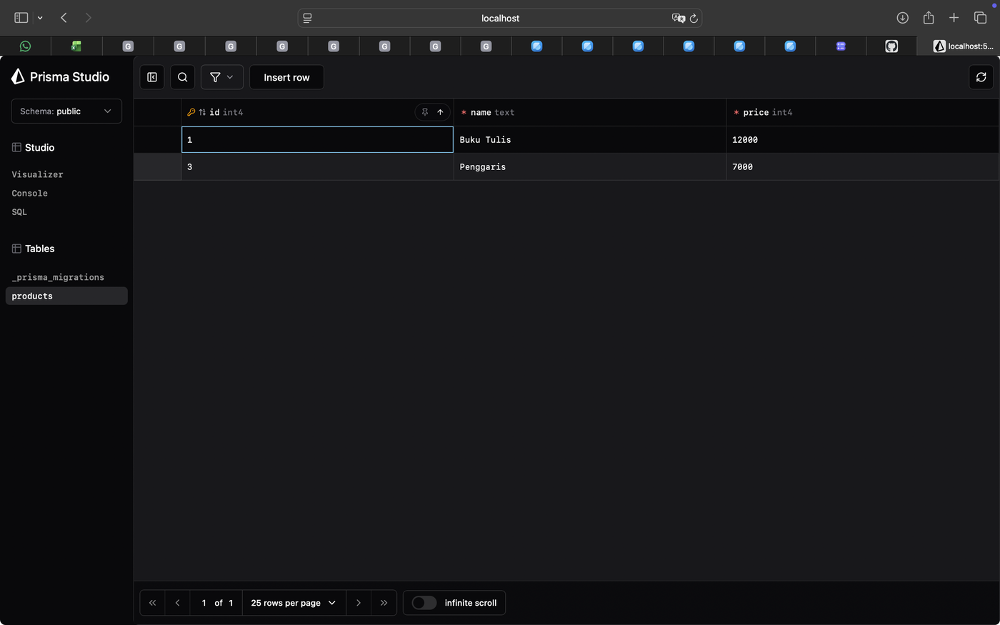 |
